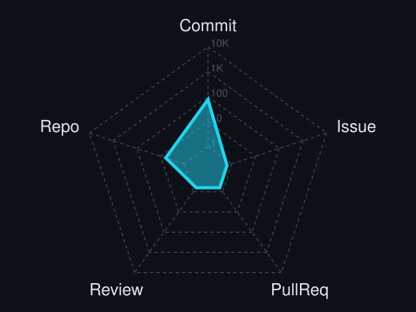
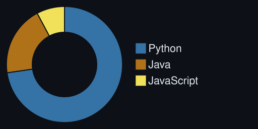
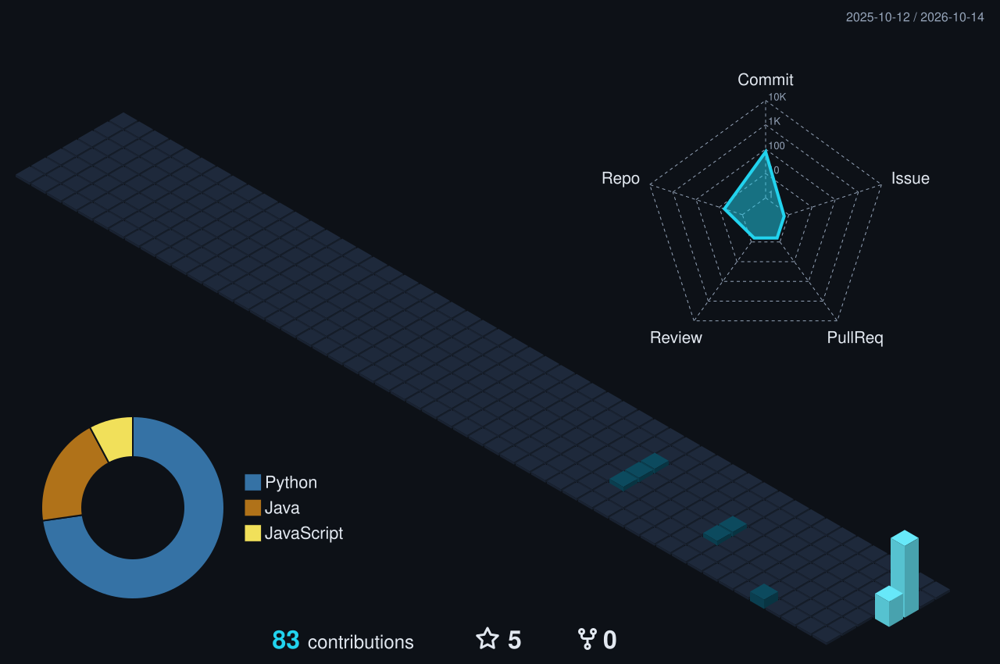

<p align="center">
  
</p>

<p align="center">
  <a href="https://git.io/typing-svg">
    
  </a>
</p>

<p align="center">
  <a href="https://www.linkedin.com/in/suryansh-verma08"></a>
  <a href="mailto:vsuryansh080405@gmail.com"></a>
  <a href="https://drawtomata.vercel.app"></a>
  <a href="https://github.com/SlazzInC0de?tab=repositories"></a>
</p>

<p align="center">
  
</p>

---

## `~/ whoami`

```console
$ cat about.txt
```

Hi, I'm **Suryansh Verma**. I build things that sit somewhere between the cloud, the web and machine learning, and I debug them when none of those three are cooperating.

- 🔨 Currently building **[Drawtomata](https://drawtomata.vercel.app)** (RE ⇄ FA, NFA/DFA, grammar and PDA conversions, drawn live) and **PadLink** (couch co-op in the browser, just plug in a controller)
- 🎓 B.Tech CSE @ **MIT Bengaluru** (2024 to 2028)
- 💼 Previously **Full-Stack Intern @ Techible & I3C, IIT Jammu** (Jun to Aug 2025)
- 🎯 Open to **SDE / ML internships**
- ⚡ Fun fact: Drawtomata exists because I kept fumbling NFA to DFA conversions in exams, so I built the tool I wished I had.

---

<h2 align="center"><code>~/ toolbox</code></h2>

<p align="center">
  
  <br/>
  
</p>

---

<h2 align="center"><code>~/ skill radar</code></h2>

<p align="center">
  
  
</p>

---

<h2 align="center"><code>~/ featured builds</code></h2>

<table>
<tr>
<td colspan="2" valign="top">

#### ✏️ [Drawtomata](https://github.com/SlazzInC0de/drawtomata) · [live ↗](https://drawtomata.vercel.app)
Interactive Theory of Computation workbench. Convert between regular expressions, NFAs, DFAs, grammars and PDAs and watch every step drawn out, instead of guessing in an exam hall.


</td>
</tr>
<tr>
<td colspan="2" valign="top">

#### 🎯 [Smart Shortlisting Engine](https://github.com/SlazzInC0de/smart-shortlisting-engine)
Hybrid AI candidate-ranking engine built for the **InternLoom AI Hackathon**. Combines exact skill parsing with semantic resume-vs-JD matching using local **all-MiniLM-L6-v2** embeddings. Fully local, privacy-first, zero external API calls.


</td>
</tr>
<tr>
<td width="50%" valign="top">

#### ☁️ [StratoFlow](https://github.com/SlazzInC0de/stratoflow)
Event-driven serverless data pipeline on **Azure**. Blob upload triggers Functions that validate (Pandera), transform and load data to Parquet, queried via **Synapse Serverless SQL**. Full infra in **Terraform**, CI/CD on **GitHub Actions**.

`61% smaller than CSV via Parquet (measured) · 11 tests · 96% coverage`


</td>
<td width="50%" valign="top">

#### 💼 [GradIntern](https://github.com/SlazzInC0de/gradintern)
Full-stack internship marketplace with custom **JWT + role-based access control** middleware. REST API on Express 5 and MongoDB Atlas, frontend in React 19 + Tailwind 4.

`15 API tests · 100% route coverage · ~1 ms p50 API overhead (benchmarked)`


</td>
</tr>
<tr>
<td width="50%" valign="top">

#### 📚 [Imazinthecomicz](https://github.com/SlazzInC0de/imazinthecomicz)
Semantic comic recommendation engine. Embeds plots with **all-MiniLM-L6-v2** (SentenceTransformers) and ranks by cosine similarity, served through a comic-styled **Streamlit** UI.


</td>
<td width="50%" valign="top">

#### 🏛️ [Enterprise Library OS](https://github.com/SlazzInC0de/Enterprise-Library-OS)
Desktop library management system with a **JavaFX** interface and **SQLite** persistence. Handles catalog, members, issue and return flows.


</td>
</tr>
</table>

---

<h2 align="center"><code>~/ contributions calendar</code></h2>

<p align="center">
  
</p>

---

<h2 align="center"><code>~/ the numbers</code></h2>

<p align="center">
  
  
</p>

<p align="center">
  
</p>
